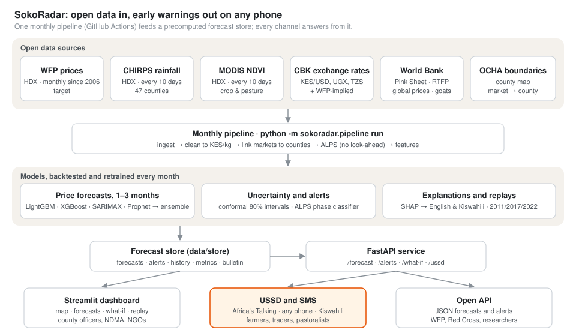

# SokoRadar

**Early warning of staple food price shocks in Kenya.**

SokoRadar forecasts monthly prices of maize, beans, maize flour and goat meat in WFP-monitored
Kenyan markets one to three months ahead. It rates each forecast on WFP's Alert for Price Spikes
scale (Normal, Stress, Alert, Crisis) and explains the main drivers in English and Kiswahili.
Forecasts reach users through a web dashboard, an open API and a USSD/SMS menu that works on any
phone.

Moringa School · Module 6 capstone · [Proposal](SokoRadar_Capstone_Proposal.pdf) · [Final report](reports/final_report.md)



## Live links

- Dashboard: [add link]
- API documentation: [add link]/docs
- USSD (Africa's Talking sandbox): [add service code]

## Features

- 1–3 month price forecasts for 67 market series, with 80% prediction intervals
- Alerts on WFP's ALPS scale, with the probability of reaching Alert or Crisis
- The main drivers of each forecast in plain English and Kiswahili
- Dashboard: alert map, market view, what-if rainfall scenarios, replays of the 2011, 2017 and
  2022 droughts, and accuracy tracking
- REST API, USSD menu and SMS alerts
- Automated monthly refresh: download, retrain, forecast and publish

## Results

Backtests over 2015–2025, each year forecast with models trained only on earlier years; 2026 is
held out.

| Metric | Target | Result |
|---|---|---|
| MASE (scaled by seasonal naive), 1–3 months | below 1.0 | 0.38 / 0.50 / 0.60 |
| MAE vs last month's price, 2–3 months | 10% lower | 2.3% / 1.8% lower (7–11% on wholesale markets) |
| Actual prices inside the 80% interval | 75–85% | 78–79% |
| Alert recall / precision, 1 month ahead | 0.70 / 0.50 | 0.83 / 0.67 |
| Alert recall / precision, 2 months ahead | 0.70 / 0.50 | 0.82 / 0.33 |
| Warning before current-month ALPS in drought replays | at least 1 month | 23 of 25 episodes, 1.8 months on average |
| Dashboard and USSD response | under 3 s and 2 s | 0.45 s and under 0.2 s |
| Unaided USSD use | 8 of 10 users | not yet tested |

Methods, full results and limitations are in the [final report](reports/final_report.md).

## Tech stack

Python · pandas · LightGBM · XGBoost · statsmodels (SARIMAX) · Prophet · conformal prediction ·
SHAP · FastAPI · Streamlit · Docker on Render · GitHub Actions · Africa's Talking

## Repository

| Folder | Contents |
|---|---|
| `src/sokoradar/` | Data pipeline, models, alerts, USSD and SMS |
| `api/` | FastAPI service |
| `dashboard/` | Streamlit dashboard |
| `notebooks/` | Exploratory analysis, model comparison, alerts and explainability |
| `reports/` | Final report and figures |
| `docs/` | Data dictionary, data quality report, API reference |
| `tests/` | Automated tests |

## Run locally

```bash
pip install -r requirements.txt
pip install -e . --no-deps
streamlit run dashboard/app.py
uvicorn api.main:app
```

## Data

WFP market prices (CC BY-IGO), CHIRPS rainfall and MODIS vegetation indices (WFP, Climate Hazards
Center and NASA, via the Humanitarian Data Exchange), Central Bank of Kenya exchange rates, World
Bank commodity prices and Real-Time Food Prices (CC BY 4.0), and OCHA administrative boundaries.

## Team

| Name | Role |
|---|---|
| [Name] | Data engineer |
| [Name] | Forecasting lead |
| [Name] | Alerts and explainability lead |
| [Name] | Deployment engineer |
| [Name] | Product and impact lead |

*Forecasts are early warning, not certainty and not trading advice.*
