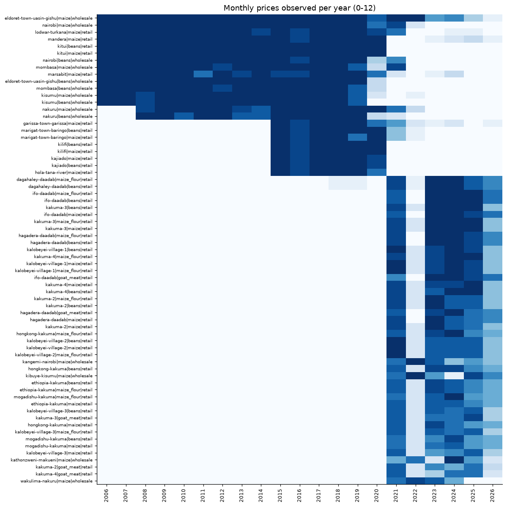
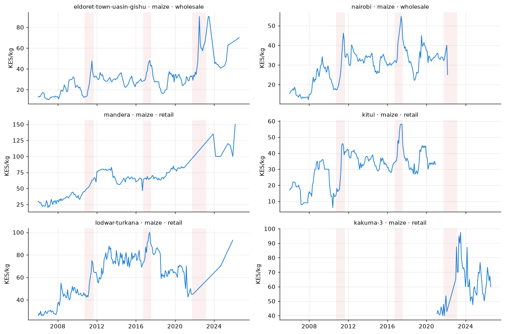
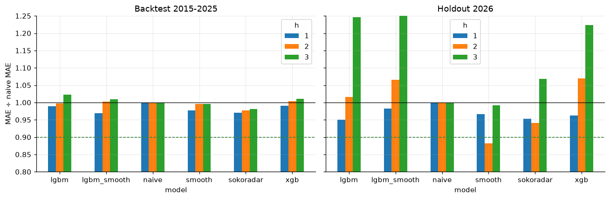
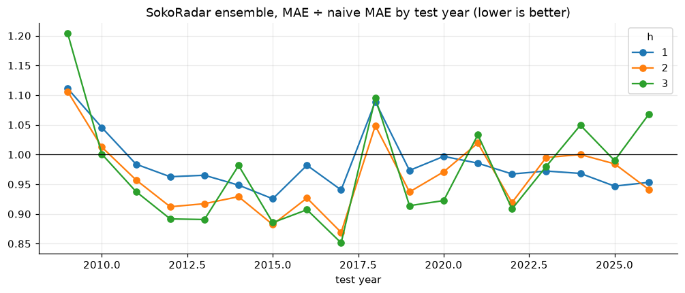
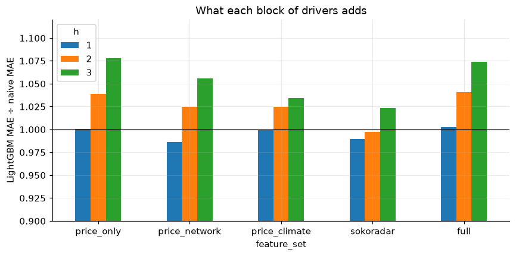
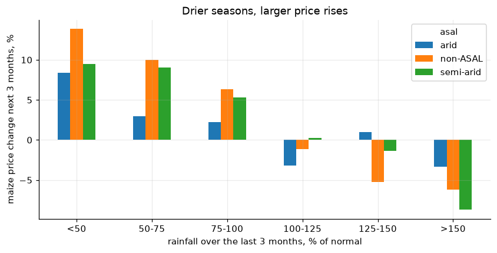
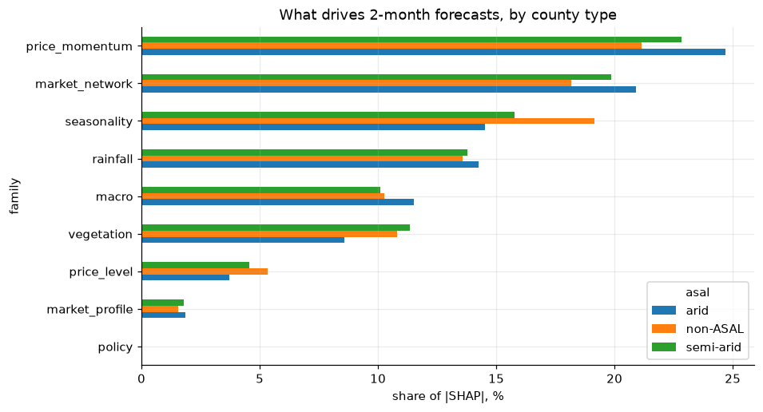
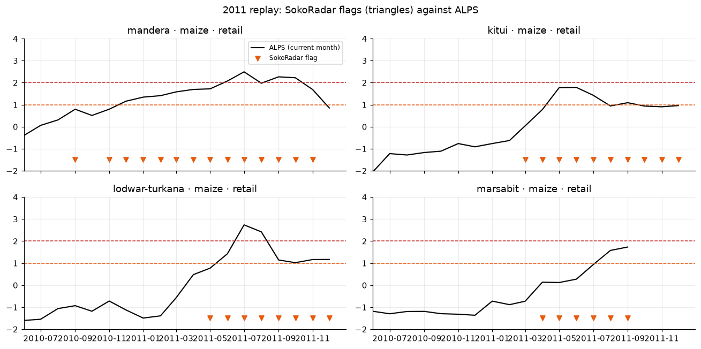
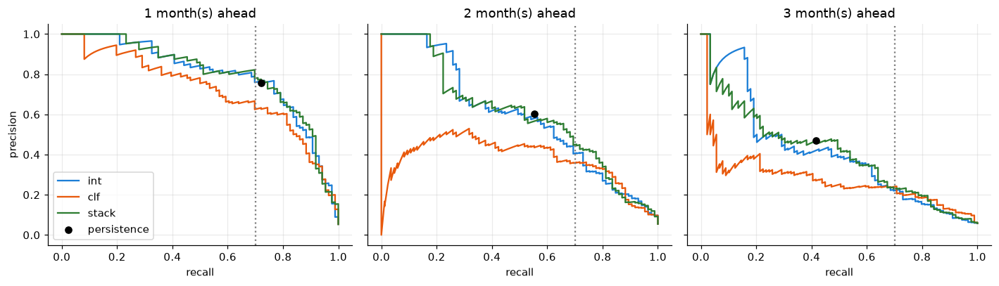
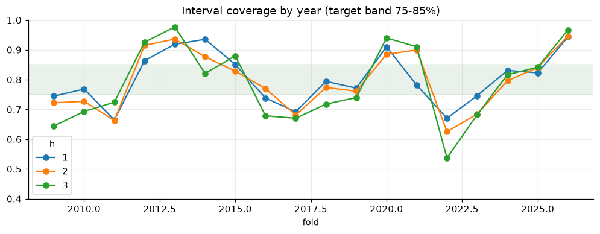

# SokoRadar — final report

**An AI early-warning system for staple food price shocks in Kenya**
Moringa School capstone · module 6 · data to September 2026 · report generated October 2026

---

## 1. Summary

Kenya's hunger crisis reaches households through prices, yet today's market alerts flag a market
only after prices have spiked. SokoRadar forecasts monthly maize, beans, maize-flour and goat-meat
prices in WFP-monitored Kenyan markets one to three months ahead. It turns those forecasts into WFP
ALPS phases (Normal, Stress, Alert, Crisis), explains each one in English and Kiswahili, and
delivers them through a dashboard, an open API and a USSD/SMS menu for basic phones. A single
command refreshes the whole system each month.

On 2015–2025 rolling-origin backtests (each year forecast only from earlier years):

- **Price forecasts** beat the seasonal-naive benchmark by a wide margin (MASE 0.38–0.60 against
  0.94–1.00). They beat the much harder last-month (naive) forecast by **2–3% overall**. The edge
  grows to **7–11% for wholesale maize and beans at 2–3 months** and **13–15% in the 2017 crisis**.
  The proposal's target of 10% better than naive at 2–3 months is **met only in those segments, not
  overall**.
- **80% prediction intervals** contain **78–79%** of actual prices at every horizon (target 75–85%).
- **Alerts** catch **83% of Alert/Crisis months one month ahead with 67% precision** (target met).
  Two months ahead recall stays at 82%, but precision falls to 33% (target 50%, not met). The
  models anticipate **63% of new alerts two months ahead**, which today's current-month ALPS
  cannot do by construction.
- **In replays of 2011, 2017 and 2022, 23 of 25 alert episodes (92%) were flagged at least one
  month before ALPS turned Alert, on average 1.8 months earlier.** This is the project's core promise.

Everything runs on free tiers. User testing of the USSD menu with farmers and traders is the one
success metric not yet measured.

## 2. Problem and users

About 2.7 million people in Kenya's arid and semi-arid lands (ASALs) faced crisis-level food
insecurity in July–October 2026. Food inflation reached 9.5% in September 2026, and in Wajir and
Mandera a goat bought roughly 40% less maize than a year earlier. WFP's ALPS indicator and the
Ministry of Agriculture's KAMIS report *current* prices. County governments, NDMA, aid agencies,
traders and farmers lack *forward-looking*, market-level warnings, so responses come after the spike.

| User | Decision | What SokoRadar gives | Channel |
|---|---|---|---|
| NDMA and county drought coordinators (persona: Amina, Garissa) | Escalate drought phase, request cash-transfer top-ups | Markets expected in Alert 1–3 months ahead, monthly bulletin | Dashboard, bulletin |
| WFP, Kenya Red Cross, NGOs | Transfer values, timing of local purchases | Forecasts with intervals, open API | Dashboard, API |
| County agriculture and livestock departments | Market support, livestock offtake | Forecasts and drivers by market | Dashboard |
| Farmers and traders (persona: Wekesa, Bungoma) | Sell now, store or buy | Next-month price, range and phase | USSD, SMS |
| Pastoralists | When to sell livestock | Goat-to-maize terms of trade outlook | USSD, SMS, dashboard |

## 3. Data

| Dataset | Provider | Coverage used | Role |
|---|---|---|---|
| Kenya – Food Prices | WFP via HDX | 28,463 rows, 226 markets, 2006-01 to 2026-09 | Target and price features |
| Rainfall indicators, subnational (CHIRPS) | WFP / Climate Hazards Center via HDX | Dekadal, 1981–Oct 2026, 73 districts → 47 counties | Climate drivers, what-if |
| NDVI, subnational (MODIS) | WFP / NASA via HDX | Dekadal, 2002–Sep 2026 | Crop and pasture condition |
| Indicative exchange rates | Central Bank of Kenya | Daily, 2016–Jan 2024, gaps filled with the rate implied by WFP's KES and USD prices | Exchange-rate pass-through |
| Pink Sheet | World Bank | Monthly, to Sep 2026 | Global maize, wheat, oil, fertilizer (ablation) |
| Real-Time Food Prices | World Bank via HDX | 234 markets, 2007–Aug 2026 (3–5% observed) | Live-goat prices for terms of trade; never ground truth |
| Administrative boundaries | OCHA via HDX | 47 counties | Market-to-county linking, map |

**Preparation.** WFP commodity names were mapped to four staples, and units (kg, 90 kg bags, 200 g
packets, litres) converted to KES/kg. Six duplicate market names were merged (e.g. *Garissa* and
*Garissa town*), while numbered markets such as Kalobeyei villages 1–3 stay distinct. Three unit-slip
outliers were removed, and retail and wholesale were kept apart. Only series with at least 36
monthly prices were kept, WFP's minimum for a seasonal trend. That leaves **67 series, 30 markets
and 5,386 monthly prices**. Targets are never gap-filled. The climate files use pre-2013 districts
whose codes start with today's county code, so districts were aggregated to counties weighted by
satellite pixels. The full data quality report is generated at `docs/data_quality_report.md`.



The long histories (2006–2020) come from the big wholesale markets and a few ASAL retail markets.
The refugee-camp markets of Kakuma, Kalobeyei and Dadaab start in 2021 and supply most of today's
live series.



## 4. Methods

SokoRadar follows CRISP-DM. Every model is judged against simple baselines on forecasts it could
have made at the time.

**ALPS without look-ahead.** ALPS = (observed − expected price) ÷ residual SD, where the expected
price comes from a regression on a linear trend and 12 month dummies. WFP fits that regression on the
full history, which leaks the future into historical ALPS. SokoRadar refits it every month on past
prices only (tested in `tests/test_alps.py`). Forecast prices are placed on the same scale with the
trend fitted at the forecast origin.

**Features** (one row per series and origin month, all known at the origin):
- **price memory:** lags of 1–12 months, rolling means, volatility, months since the last price
- **level:** today's ALPS and its change
- **seasonality:** the series' own month-to-month change in past years, and the calendar of the target month
- **market network:** a national index, the gap to the Nairobi wholesale price, the gap to the nearest market
- **climate:** county rainfall as % of normal over the last 1–6 months, and NDVI anomalies
- **exchange rate** and **policy flags**

**Models**, each trained per horizon (1, 2, 3 months):

| Stage | Models |
|---|---|
| Baselines | Naive (last month), seasonal naive (same month last year), smoothed level |
| Statistical | SARIMAX(1,1,0)(1,0,0)₁₂ on log prices with 3-month-lagged rainfall, NDVI and exchange-rate regressors; Prophet with the lagged price as a regressor |
| Machine learning | Global LightGBM (two anchors: last price and smoothed level) and XGBoost, trained across all markets on absolute error |
| Ensemble | Adaptive: weights ∝ 1/MAE² of each component's out-of-sample errors in the previous 3 years, per commodity × price type |
| Alerts | Class-weighted LightGBM phase classifier; interval-derived probability; logistic stack of both with today's ALPS |

**Uncertainty.** LightGBM 10% and 90% quantile models, conformalized with CQR (Romano et al. 2019)
on the previous three years' out-of-sample errors. The implementation matches MAPIE's
`ConformalizedQuantileRegressor` with symmetric correction to within 0.01 (`tests/test_models.py`).

**Explanations.** SHAP values of the LightGBM forecaster, summed by driver family, become one
sentence per forecast in English and Kiswahili with the direction and the number behind it.

**Validation.** Rolling origin: fold *Y* trains on every pair whose target month is on or before
December *Y*−1 and forecasts every origin in *Y*. That gives 14,691 out-of-sample forecasts across
folds 2009–2026. Ensemble weights, interval corrections, the alert stack and alert thresholds for
fold *Y* use only folds before *Y*. Metrics are reported for 2015–2025; 2026 is the untouched
holdout. Crisis replays rerun the system through 2011, 2017 and 2022.

## 5. Results

### RQ1 — How far ahead can price spikes be predicted, and how accurately?

| Model (2015–2025) | MAE % 1 m | 2 m | 3 m | MAE ÷ naive 1 m | 2 m | 3 m | MASE 1 m | 2 m | 3 m |
|---|---|---|---|---|---|---|---|---|---|
| Seasonal naive | 16.4 | 16.8 | 17.2 | 2.09 | 1.79 | 1.57 | 0.94 | 0.97 | 1.00 |
| Naive (last month) | 6.9 | 8.9 | 10.7 | 1.00 | 1.00 | 1.00 | 0.40 | 0.52 | 0.63 |
| LightGBM | 6.8 | 8.6 | 10.3 | 0.99 | 1.00 | 1.02 | 0.39 | 0.50 | 0.62 |
| XGBoost | 6.7 | 8.6 | 10.2 | 0.99 | 1.00 | 1.01 | 0.39 | 0.51 | 0.61 |
| **SokoRadar ensemble** | **6.7** | **8.5** | **10.1** | **0.971** | **0.977** | **0.982** | **0.38** | **0.50** | **0.60** |

On the longer series, where SARIMAX and Prophet also run, the ensemble's edge over naive is larger:
0.974 / 0.959 / 0.951. Prophet was poor (1.6× naive), and SARIMAX roughly tied naive.

| Segment (ensemble ÷ naive MAE) | 1 m | 2 m | 3 m |
|---|---|---|---|
| Wholesale maize | 0.970 | 0.926 | **0.895** |
| Wholesale beans | 0.951 | **0.903** | **0.893** |
| Retail maize | 0.977 | 0.951 | 0.946 |
| Retail beans | 0.967 | 0.973 | 0.991 |
| Retail maize flour (camps) | 0.974 | 1.000 | 1.019 |
| Retail goat meat (camps) | 0.973 | 1.049 | 1.063 |




**Answer.** Prices can be forecast 1–3 months ahead with typical errors of about 7%, 9% and 10%,
inside honest 80% ranges of roughly ±11%, ±15% and ±19%. Month-to-month changes are close to a
random walk, so the last price is hard to beat. SokoRadar's advantage is largest where it matters
most:
- **shock years:** 2017 is 6% / 13% / 15% better than naive, 2022 is 3% / 8% / 9% better
- **wholesale markets** that lead national prices: about 10% better at 3 months

It loses in 2018, when prices collapsed after the 2017 crisis, and on the noisy camp retail series
in their first year (2021). On the 2026 holdout it was 4.7% and 5.9% better than naive at 1 and 2
months but 6.8% worse at 3 months.

### RQ2 — Do satellite rainfall and vegetation improve forecasts beyond price history?

LightGBM with nested feature sets, same backtest (MAE ÷ naive):

| Features | 1 m | 2 m | 3 m |
|---|---|---|---|
| Price history only | 1.000 | 1.039 | 1.078 |
| + market network | 0.987 | 1.025 | 1.056 |
| + rainfall and NDVI (no network) | 1.000 | 1.024 | 1.034 |
| **Production set** (price + network + climate + exchange rate + policy) | **0.990** | **0.997** | **1.023** |
| Everything incl. global Pink Sheet prices | 1.003 | 1.041 | 1.074 |



**Answer: yes, at 2–3 months.** Adding rainfall and vegetation to price history cuts the 3-month
error by 4.4 points relative to naive (1.078 → 1.034) and the 2-month error by 1.5 points. They do
nothing at one month, where momentum dominates. Global commodity prices added noise and are left
out of production. In the raw data, drier seasons are followed by larger maize price rises in every
county type, most steeply where maize is grown:



### RQ3 — Which drivers explain price shocks in pastoral versus high-potential markets?

Share of mean |SHAP| by driver family, 2-month forecasts:

| Driver family | Arid (pastoral) | Semi-arid | Non-ASAL (high potential & cities) |
|---|---|---|---|
| Price momentum | **24.7%** | 22.8% | 21.1% |
| Market network | **20.9%** | 19.9% | 18.2% |
| Seasonality | 14.5% | 15.8% | **19.1%** |
| Rainfall | **14.2%** | 13.8% | 13.6% |
| Exchange rate | **11.5%** | 10.1% | 10.3% |
| Vegetation | 8.6% | **11.4%** | 10.8% |
| Price level (ALPS) | 3.7% | 4.5% | **5.3%** |



**Answer.** Forecasts in pastoral markets lean more on recent momentum, on prices elsewhere in the
network (they import their maize), on rainfall and on the shilling. Forecasts in high-potential
markets and cities lean more on the harvest calendar, local vegetation and mean reversion to trend.
The same pattern holds at 1 and 3 months (momentum 34% vs 25% at one month; seasonality 16% vs
20% at three). Policy flags received no weight: the four recorded events are too few to learn from.

### RQ4 — Does a forecast-based alert warn earlier than current-month ALPS?

| Replay | Episodes (ALPS reaches Alert) | Warned ≥ 1 month earlier | Mean lead | Flags followed by an Alert within 3 months |
|---|---|---|---|---|
| 2011 | 15 | 13 (87%) | 1.6 months | 235 of 326 (72%) |
| 2017 | 9 | 9 (100%) | 2.0 months | 127 of 231 (55%) |
| 2022 | 1 | 1 (100%) | 3.0 months | 29 of 38 (76%) |
| **All** | **25** | **23 (92%)** | **1.8 months** | |



**Answer: yes.** With models trained only on data before each crisis:
- Mandera retail maize was flagged in September 2010, three months before ALPS reached Alert in December.
- Marsabit was flagged in May 2011, three months before its August onset.
- Mombasa wholesale maize was flagged in February 2011, three months before its May onset.
- In 2017, the wholesale maize markets of Eldoret, Nakuru, Kisumu, Nairobi and Mombasa were all flagged
  in January, 1–3 months before ALPS turned Alert.

Most flags in crisis windows were followed by an actual Alert within three months.

### Alerts in the full backtest

| Route (2015–2025) | Recall 1 m | Precision 1 m | Recall 2 m | Precision 2 m | Recall 3 m | Precision 3 m | New alerts caught 1 / 2 / 3 m |
|---|---|---|---|---|---|---|---|
| Persistence (today's ALPS carried forward) | 0.72 | 0.76 | 0.55 | 0.60 | 0.42 | 0.47 | 0 / 0 / 0 |
| Interval probability | 0.76 | 0.77 | 0.78 | 0.34 | 0.76 | 0.20 | 21% / 53% / 62% |
| Stacked | 0.76 | 0.76 | 0.77 | 0.38 | 0.78 | 0.24 | 21% / 47% / 62% |
| **Phase classifier (selected)** | **0.83** | **0.67** | **0.82** | **0.33** | **0.83** | **0.22** | **42% / 63% / 71%** |



The classifier route was selected by F2 score, which weights recall four times as heavily as
precision, following the proposal's priority ("a missed crisis costs more than a false alarm").
Thresholds are re-tuned each year on earlier years for recall ≥ 0.70. Any forecast whose own price
lands in Alert is also shown as Alert. At 2–3 months the precision cost is real: roughly two in
three longer-range alerts do not materialise. The dashboard and SMS therefore always show the
probability next to the phase.

### Uncertainty

| Horizon | Coverage of the 80% interval | Raw quantile coverage | Median interval width |
|---|---|---|---|
| 1 month | 78.6% | 72.3% | 22% (≈ ±11%) |
| 2 months | 78.9% | 71.7% | 30% |
| 3 months | 78.1% | 72.0% | 38% |



Conformal calibration fixes the raw quantile models' under-coverage. In the calm 2026 holdout,
coverage was 94–97%: intervals calibrated on volatile years are conservative in quiet ones.

## 6. Success metrics

| Area | Metric | Target | Result | Status |
|---|---|---|---|---|
| Forecasting | MASE vs seasonal naive | < 1.0 at all horizons | 0.38 / 0.50 / 0.60 | ✅ |
| Forecasting | MAE vs naive at 2–3 months | ≥ 10% lower | 2.3% / 1.8% lower overall; 7–11% for wholesale; 13–15% in 2017 | ❌ overall |
| Uncertainty | Actual prices inside 80% interval | 75–85% | 78.6% / 78.9% / 78.1% | ✅ |
| Alerts | Recall / precision, 1–2 months | ≥ 0.70 / ≥ 0.50 | 0.83 / 0.67 (1 m); 0.82 / 0.33 (2 m) | ✅ 1 m, ❌ 2 m precision |
| Alerts | Lead time in crisis replays | ≥ 1 month earlier than ALPS | 92% of episodes, mean 1.8 months | ✅ |
| Product | Dashboard load | < 3 s | 0.45 s per interaction; ≈ 3 s cold start | ✅ |
| Product | USSD reply time and depth | < 2 s, ≤ 3 screens | 15–190 ms; answer on screen 3; ≤ 182 chars | ✅ |
| Product | Unaided USSD task completion | 8 of 10 users | Not yet tested | ⏳ |
| Operations | Refresh from one trigger | No manual steps | `python -m sokoradar.pipeline run`, monthly GitHub Action | ✅ |

## 7. Deployment


- **Live:** dashboard at [sokoradar.streamlit.app](https://sokoradar.streamlit.app), API documentation
  at [sokoradar-api.onrender.com/docs](https://sokoradar-api.onrender.com/docs), and the USSD code `*384*79278#` in the
  Africa's Talking sandbox simulator.
- **Pipeline:** `python -m sokoradar.pipeline run` runs ingest → prepare → backtest and evaluate →
  train → forecast → publish in about 15 minutes. A GitHub Action runs it on the 6th of every month,
  runs the tests and commits the refreshed store, which redeploys the API (Render deploy hook) and the
  dashboard (Streamlit Community Cloud).
- **API:** FastAPI in Docker (`Dockerfile`, `render.yaml`) with endpoints for forecasts, alerts,
  history, terms of trade, what-if, accuracy, replays, the bulletin, the Africa's Talking USSD
  callback and an admin-only SMS broadcast. See `docs/api.md`.
- **Dashboard:** Streamlit with seven tabs:
  - alert map
  - market forecast with fan chart, drivers and terms of trade
  - what-if rainfall slider
  - crisis replay
  - accuracy and live scorecard
  - in-app USSD phone
  - data and method

  Maps use SVG geo projections with bundled county shapes, so they work offline.
- **USSD and SMS:** a stateless Kiswahili menu with an English toggle, tested in the Africa's
  Talking sandbox format. SMS subscription records consent; numbers are stored as salted hashes,
  with an encrypted copy for delivery.
- **Bulletin:** a Markdown bulletin for NDMA and county coordinators each month (`docs/bulletins/`).
- **Track record:** every live forecast is archived and scored once the actual price arrives. The
  2026 holdout seeds the scorecard.

Live forecasts at the time of writing (data to September 2026) cover 42 series in 5 counties.
Eldoret wholesale maize is in Alert: its ALPS is already 1.6 and the forecast stays above the
Alert line. Kakuma 3 goat meat carries a 24–46% Alert risk for October–November, driven by rains
at 27% of normal over the last three months.

## 8. Risks, ethics and mitigation (as built)

| Risk | What the system does |
|---|---|
| Patchy remote-market data | Only series with ≥ 36 months; data age on every forecast; only series with a price in the last 3 months are live |
| Policy shocks the data cannot see | Policy event flags (`config/policy_events.csv`); human review recommended before alerts are published; intervals and probabilities always shown |
| False alarms or missed crises | Recall-first thresholds tuned out of sample; probabilities and ranges shown; precision at 2–3 months reported openly |
| Traders hoarding on forecasts | County alerts published openly to everyone at the same time; framed as early warning, not trading advice |
| Free hosting sleeps, USSD times out | All answers precomputed; USSD answers in milliseconds; API warmed up before demos; backup demo video |
| KAMIS access changes | Not used; the core system runs on HDX, World Bank and CBK data |
| Licensing | All sources credited in the dashboard, API and README |
| Subscriber privacy | Salted hash plus encrypted number, county only, consent screen, deletion on unsubscribe, sandbox only during the capstone |

## 9. Limitations and future work

- **Data depth.** Only 67 series pass the 36-month rule. The live system covers 5 counties, mostly
  refugee-camp markets. Joining KAMIS (five markets per county) is the main route to all 47 counties.
- **The naive bar.** Overall gains over the last price are a few percent. Better use of
  cross-border prices (Uganda, Tanzania, Somalia from WFP) and of rainfall *forecasts* rather than
  observed rainfall are the most promising next features.
- **Alert precision at 2–3 months** is low. A cost-sensitive threshold per user group (county
  officers may accept more false alarms than traders) would serve users better than one threshold.
- **Goat prices** come from World Bank modelled estimates. WFP or NDMA livestock price data would
  make the terms-of-trade outlook stronger.
- **IPC validation** (do price alerts lead IPC deterioration?) needs county-level IPC history; only
  the latest analysis is on HDX.
- **User testing** with 10 farmers and traders is still to be done.
- **Stretch goals not done:** N-BEATS/TFT (data too short and gappy) and beating the World Bank RTFP
  estimates. RTFP is re-estimated with all data, so it is not a fair out-of-sample benchmark.

## 10. Reproducibility

```bash
pip install -r requirements.txt && pip install -e . --no-deps
python -m sokoradar.pipeline run      # rebuilds every number in this report
pytest -q                             # automated tests
```

Notebooks: `notebooks/01_eda_and_data_quality.ipynb`, `02_model_comparison.ipynb` and
`03_alerts_explainability_replays.ipynb`. Metrics: `data/store/metrics.json`.

## References

1. Capital FM (14 Sep 2026). 2.7mn Kenyans face crisis-level food insecurity in ASALs, IPC report finds.
2. Trading Economics (30 Sep 2026). Kenya inflation rate quickens to over 2-1/2-year high.
3. FAO GIEWS (4 May 2026). Country brief: Kenya.
4. Capital FM (26 Aug 2026). 80pc of Kenya faces above-average rains, prolonged wet spells.
5. WFP (2014). Technical guidance note: calculation and use of the Alert for Price Spikes (ALPS) indicator.
6. WFP via HDX. Kenya – Food Prices; Kenya rainfall and NDVI indicators at subnational level.
7. Andrée, B. P. J. (2021). Monthly food price estimates by product and market, Kenya. World Bank.
8. World Bank. Commodity Markets (Pink Sheet). Central Bank of Kenya. Foreign exchange rates.
9. Romano, Y., Patterson, E. & Candès, E. (2019). Conformalized quantile regression. NeurIPS.
10. Lundberg, S. & Lee, S.-I. (2017). A unified approach to interpreting model predictions. NeurIPS.
11. Africa's Talking. USSD and SMS API documentation (sandbox).
